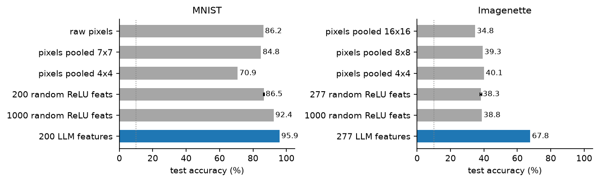
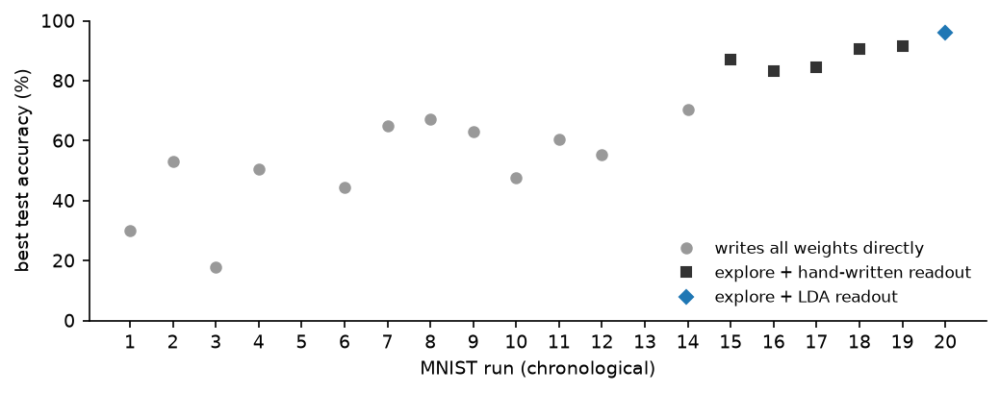
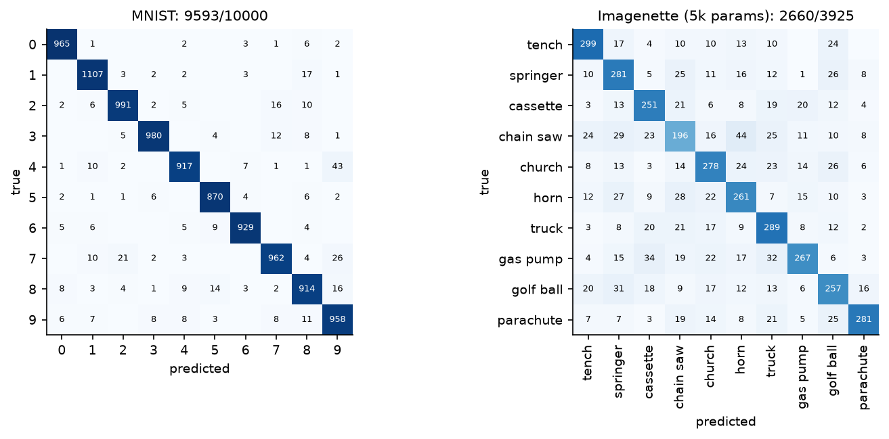

# llm-weight-programming

I wanted to see how far an LLM gets if it has to write a neural network's weights by hand: no backprop, no training loop, just numbers typed into a JSON file. Claude Opus 5.5 wrote every conv weight for a small MNIST network and a small Imagenette network. The final linear layer is closed-form LDA, which the model computed itself from statistics the harness gave it.

Test accuracy (the test sets were never shown to the model):

- MNIST: 95.93% (10,000 images, 6,779 parameters)
- Imagenette, 10 classes at 64×64: 67.77% (3,925 val images, 5,304 parameters)

This is not a "zero data" result. The model saw 100 example images, and after each round it got per-class statistics for its neurons on 5,000 labelled training images. More on that below.

## Does the LLM matter, or is it all LDA?

This was the first thing I wanted to know. [`audit_ablation.py`](audit_ablation.py) takes the exact LDA recipe from the model's calculator log, fits it on the same 5,000 training images, and swaps the LLM's features for raw pixels or random ReLU features of the same width:



| features into the same LDA readout | MNIST | Imagenette |
|---|---|---|
| raw pixels | 86.2 | 34.8 (16×16 pooled) |
| pooled pixels | 84.8 (7×7) | 40.1 (4×4) |
| random ReLU features, same width, 3 seeds | 86.2–86.9 | 37.7–38.7 |
| 1000 random ReLU features | 92.4 | 38.8 |
| LLM-written features | **95.9** | **67.8** |

So the features account for about 9 points on MNIST and about 29 on Imagenette. One caveat: the LLM refined its features over several rounds while looking at their statistics, and the random ones got no such tuning.

## How it works

There are two phases ([`src/weightspace/explore.py`](src/weightspace/explore.py)).

**Explore (3–8 rounds).** The model writes small "feature files" (conv kernels, thresholds, pooling) and says what each neuron is meant to detect. The harness runs them on 5,000 images from the training set. For each neuron it reports the mean activation per class, the std, how often it fires, and which classes produced its 50 strongest responses. The model then keeps, fixes or replaces neurons.

**Combine (2–3 rounds).** The model picks neurons from its bank and writes the final 10×N layer. It gets a Python calculator with the class means and the neuron correlation matrix preloaded. With those, it wrote regularized LDA (from [`calculator.jsonl`](results/explore-20261105-120713/calculator.jsonl), snippet 8):

```python
D=np.diag(STD); T=D@CORR@D
mu=MEANS.mean(0)
B=sum(0.1*np.outer(MEANS[k]-mu,MEANS[k]-mu) for k in range(10))
W=T-B; a=0.1
Ws=(1-a)*W+a*np.diag(np.diag(W))+1e-5*np.eye(N)
w=np.linalg.solve(Ws,MEANS.T).T
b=-0.5*np.sum(w*MEANS,1)
```

It pasted the printed numbers into its answer. After that it got validation accuracy, a confusion matrix and 10 misclassified examples. On MNIST it only adjusted the 10 biases. On Imagenette it re-solved the LDA with different priors and shrinkage. The reported model is the round with the best validation score.

## What the model wrote

Some of the MNIST kernels, exactly as typed:


These are line detectors in four orientations, an endpoint detector, and two of the eight arms of a hole detector. A later layer fires when ink is present in every direction around an empty pixel, which separates 0/6/8/9 from the rest.

For Imagenette it mostly wrote colour, edge and blob detectors (each 3×3 RGB kernel drawn as a colour, grey = 0):


Its own labels include "white disc (golf ball)", "red blob (pump/truck/saw)" and "strong green (grass)". So the 5k-parameter Imagenette model works mostly from colour and texture statistics rather than shape. Chain saw is its worst class (51.8%). A deeper run with 57k parameters (stacked convs, Sobel and colour-opponent edges) only got to 67.90%.

For comparison, here is the LDA readout layer. It looks nothing like the kernels: large weights that mostly cancel each other out.


## What the model saw

For the MNIST run:

- 100 raw training digits in the first prompt
- per-neuron class means, std, firing rate and top-50 label counts on 5,000 training images, for 200 neurons over 4 explore rounds (one round's files failed to parse)
- the full 200×200 neuron correlation matrix and the class means, as calculator variables
- validation results for 2 combine rounds, including 10 misclassified images each time

It never saw the test set or any test number. It also never saw gradients, other models' weights, or the dataset files. The calculator refuses file access, and all 83 logged snippets are in `results/`.

The per-class means it was working from:


The Imagenette runs were the same, plus labelled picture sheets of the 100 samples. The 57k run also got pictures of the photos each neuron fired on most.

## All the runs

I made 23 runs while building this (20 MNIST, 3 Imagenette), and the numbers above are the best ones. MNIST runs in order:



| setup | best MNIST test |
|---|---|
| model writes the whole network directly, no telemetry (14 runs) | 70.5 |
| + explore phase with per-class telemetry | 87.0 |
| + calculator | 90.6 |
| + list of strongly correlated neurons | 91.5 |
| + class means and correlation matrix in the calculator (model derives LDA) | 95.9 |

The test accuracy printed to my terminal after each run while I was changing the harness. The model never saw it, but I did, so treat these as best-of numbers.

## Results

[`audit_verify.py`](audit_verify.py) doesn't import anything from this repo. It rebuilds the networks from the JSON weights with plain `torch.nn` layers and evaluates them on freshly downloaded torchvision test sets. It gives the same numbers as the harness:

| weights | test set | correct | accuracy | params |
|---|---|---|---|---|
| [`weights/mnist_95.93.json`](weights/mnist_95.93.json) | MNIST test | 9593 / 10000 | 95.93 | 6,779 |
| [`weights/imagenette_67.77_5k-params.json`](weights/imagenette_67.77_5k-params.json) | Imagenette val (160px) | 2660 / 3925 | 67.77 | 5,304 |
| [`weights/imagenette_67.90_57k-params.json`](weights/imagenette_67.90_57k-params.json) | Imagenette val (160px) | 2665 / 3925 | 67.90 | 57,408 |



The networks only use conv2d (stride 1), linear, relu/abs/tanh/sigmoid, max/avg pooling, flatten, scale and shift. Preprocessing is ÷255 for MNIST; for Imagenette it is a centre crop, bicubic resize to 64×64, then ÷255.

Before publishing I had the repo audited for leaks: training data, hidden solvers, metric bugs, pretrained weights. The notes are in [docs/AUDIT.md](docs/AUDIT.md). That audit is why this README says "LDA readout" and "per-class statistics" instead of the claims in my first draft.

## Running it

```bash
uv sync
```

Check the shipped weights (downloads about 110 MB, CPU only):

```bash
uv run --extra audit python audit_verify.py
```

Run the ablation. It is CPU-heavy for a few minutes and needs the Imagenette cache first:

```bash
uv run ws-data imagenette
```

```bash
uv run python audit_ablation.py
```

Run the experiment. It drives Claude Code headless (`claude -p`) on your own subscription, with built-in tools turned off and only the calculator available:

```bash
uv run ws-explore --samples 100 --explore 4 --combine 3 --calculator --overlap --overlap-table
```

```bash
uv run ws-explore --dataset imagenette --samples 100 --sheets --calculator --overlap --overlap-table
```

Each run writes prompts, replies, the calculator log and the weights to `runs/<timestamp>/`. To regenerate the figures:

```bash
uv run --with matplotlib python docs/make_figures.py
```

## Layout

- `src/weightspace/`: the harness. `explore.py` is the two-phase loop, `network.py` is the numpy runtime (its docstring documents the weight format), `generate.py` is the older direct-write mode, `calc_server.py` is the calculator, and `walker.py` is an unrelated side experiment with a MuJoCo walker.
- `weights/`: the three models above, plus two early zero-shot MNIST attempts.
- `results/`: full logs for the three headline runs (prompts, replies, calculator logs, neuron statistics, every feature file).
- `docs/`: figures, the data behind them, and the audit notes.
