# No backprop: an LLM hand-designs vision features, a closed-form readout finishes the job

An LLM (Claude Opus 5.5) typed every convolutional weight of a small vision network as plain numbers. No gradient descent, no training loop, no pretrained weights. A harness ran its neurons on training images and reported back how each one behaved. The model then derived the final linear layer in closed form (regularized LDA) with a Python calculator.

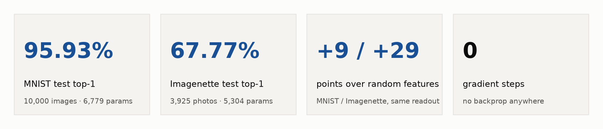

| | MNIST | Imagenette (10 classes, 64×64 RGB) |
|---|---|---|
| **Test top-1** (never shown to the model) | **95.93%** (10,000 images) | **67.77%** (3,925 photos) |
| Parameters | 6,779 | 5,304 |
| Same LDA readout on random features | 86.2–86.9% | 37.7–38.7% |
| **What the LLM's features add** | **+9.0 points** | **+29.0 points** |
| Gradient steps | 0 | 0 |

**What this is not:** it isn't "zero data". The model saw 100 example images, plus per-class statistics of its own neurons on 5,000 labelled training images. The final layer isn't hand-typed either: it is regularized LDA, which the model computed with `np.linalg.solve` and pasted in. Section 4 lays out exactly what the model saw. Before writing this up I ran a hostile audit of my own repo; [section 7](#7-self-audit) has the results.

---

## Contents

1. [The result in one chart](#1-the-result-in-one-chart)
2. [How it works](#2-how-it-works)
3. [What the LLM actually wrote](#3-what-the-llm-actually-wrote)
4. [What the LLM saw (the data budget)](#4-what-the-llm-saw-the-data-budget)
5. [Results in detail](#5-results-in-detail)
6. [How we got here: all 23 runs](#6-how-we-got-here-all-23-runs)
7. [Self-audit](#7-self-audit)
8. [Claims, precisely](#8-claims-precisely)
9. [Reproduce it](#9-reproduce-it)
10. [Repository map](#10-repository-map)

---

## 1. The result in one chart

The obvious objection: *"The LDA solver does all the work."* So we kept the readout fixed and swapped out the features. Each row below uses the **same closed-form LDA recipe the model wrote, copied from its calculator log**, on the **same 5,000 training images**. Only the features change.

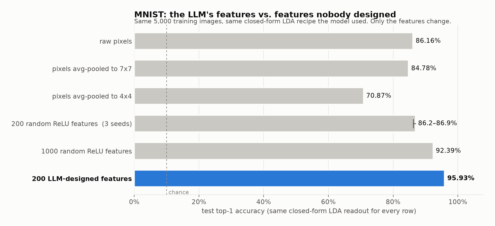

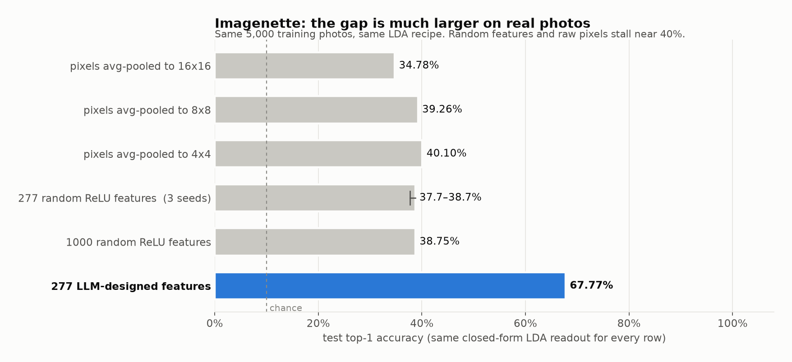

| Features fed to the same LDA readout | MNIST test | Imagenette test |
|---|---|---|
| Raw pixels (MNIST 784 / Imagenette pooled 16×16 RGB) | 86.16% | 34.78% |
| Pixels average-pooled (MNIST 7×7 / Imagenette 4×4) | 84.78% | 40.10% |
| Random ReLU projections, same width as the LLM bank (3 seeds) | 86.22–86.92% | 37.73–38.73% |
| 1,000 random ReLU projections | 92.39% | 38.75% |
| **LLM-designed feature bank** (200 / 277 neurons) | **95.93%** | **67.77%** |

On MNIST, 200 hand-designed neurons beat 1,000 random ones. On real photos, random features and raw pixels stall around 40%, while the LLM's colour, texture, edge and blob detectors reach 68%. Run [`audit_ablation.py`](audit_ablation.py) to reproduce the table.

**Caveat:** the LLM's bank was refined over several rounds using per-class telemetry, and the random features weren't, so part of the gap comes from that selection. Baselines use the LLM's own shrinkage setting, untuned.

---

## 2. How it works

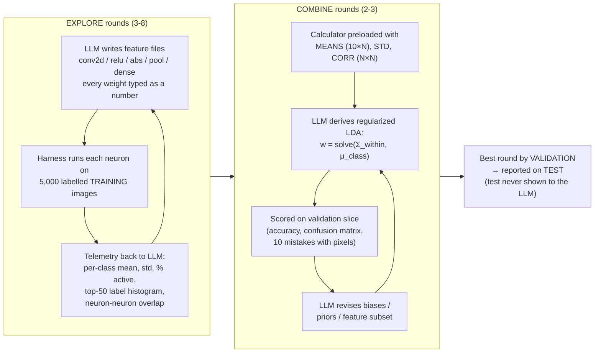

**Phase 1: neuron-level design.** The LLM never sees a gradient. It writes small "feature files" (conv kernels, thresholds, pooling) and predicts what each neuron will detect ("hole in the top-left quadrant", "red blob", "vertical edge energy"). The harness runs the neurons and reports back, for each one, its mean activation for every class, how often it fires, and which classes produce its 50 strongest responses. The LLM keeps neurons that work and fixes or replaces the ones that are dead, duplicated or behave unexpectedly.

**Phase 2: closed-form readout.** Asking a language model to hand-type 2,000 combination weights is a poor use of it, and the model knew it. Given the class means and the full correlation matrix of its own neurons, it wrote textbook regularized LDA in the calculator. Here is snippet 8 of [`calculator.jsonl`](results/explore-20261105-120713/calculator.jsonl), verbatim except for elided print lines:

```python
D=np.diag(STD); T=D@CORR@D                        # total covariance of the 200 neurons
mu=MEANS.mean(0)
B=sum(0.1*np.outer(MEANS[k]-mu,MEANS[k]-mu) for k in range(10))   # between-class scatter
W=T-B; a=0.1
Ws=(1-a)*W+a*np.diag(np.diag(W))+1e-5*np.eye(N)   # shrink 10% toward the diagonal
w=np.linalg.solve(Ws,MEANS.T).T                   # LDA weights
b=-0.5*np.sum(w*MEANS,1)                          # LDA biases
```

Its own summary in [`round_5_reply.md`](results/explore-20261105-120713/round_5_reply.md):

> *"This first combine uses all 200 neurons from all nine bank files, scored by a linear discriminant built in one closed-form step."*

The printed weights (`[8.6, 6.1, -16.9, -24.6, ...]`) are exactly the ones in the submitted file. In the next two rounds it left all 2,000 weights alone and only shifted the 10 biases, based on the validation confusion matrix.

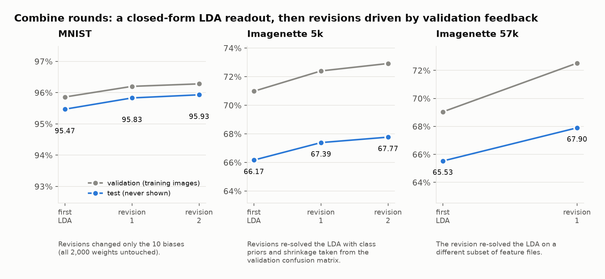

---

## 3. What the LLM actually wrote

None of the numbers below were fitted. These are kernels from the final MNIST network, exactly as the model typed them:

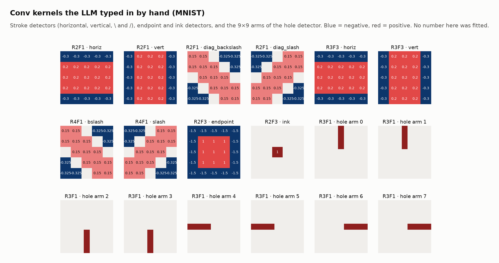

They are classic hand-engineered vision primitives: zero-sum line detectors in four orientations, an endpoint detector (a 3×3 centre surrounded by −1.5), and the eight "arms" of a hole detector. The hole detector's second layer fires only when ink exists in every direction around an empty pixel, which is how it separates 0/6/8/9 from 1/2/3/5/7.

For photos, the model wrote colour and texture detectors. Each 3×3×3 kernel below is drawn as a colour (grey = 0):

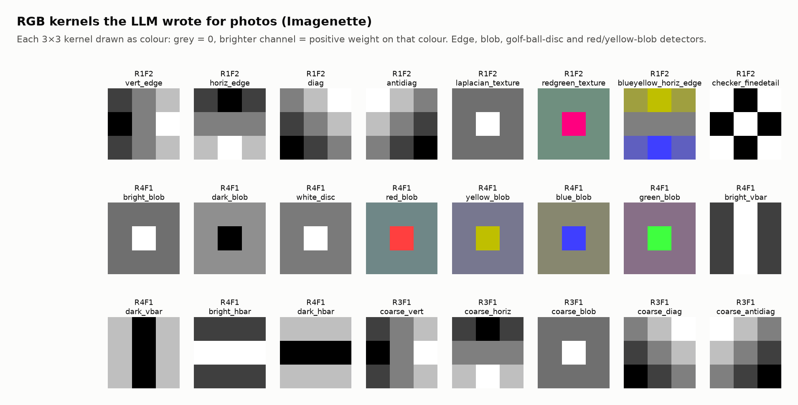

The neuron names it gave are telling: `white_disc (golf ball)`, `max red blob (pump/truck/saw)`, `strong sky blue amount`, `strong green (grass) amount`. The 5,304-parameter Imagenette model is mostly **colour, texture and blob statistics**, not object shape. That's why chain saw (51.8%) is its weakest class and garbage truck and tench, with distinctive colours and scenes, are the strongest.

The deeper, layered Imagenette run (57,408 parameters, up to 4 conv layers per branch, Sobel/Laplacian and colour-opponent edges) reached 67.90%, only 0.13 points better.

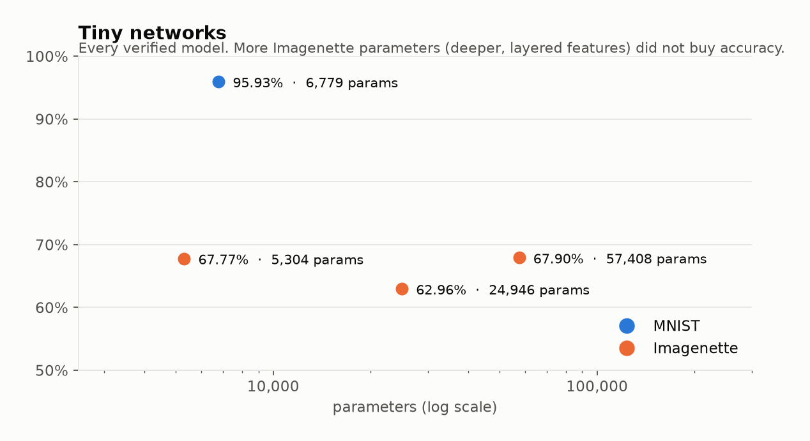

### The final layer, for contrast

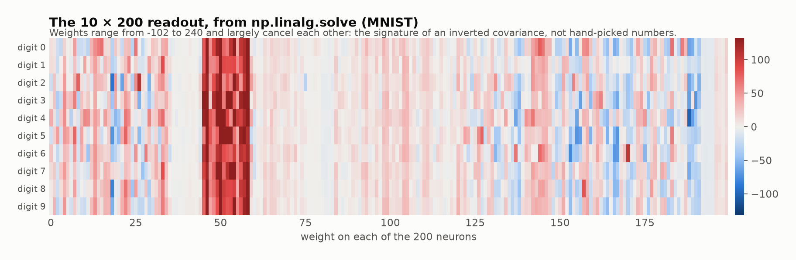

The readout looks nothing like the kernels. Its weights reach 240 and largely cancel each other out, the fingerprint of an inverted covariance matrix. This is the part of the network the LLM *computed* rather than *wrote*.

---

## 4. What the LLM saw (the data budget)

**Zero gradient steps doesn't mean zero data.** Here is everything about the training set that entered the model's context in the headline MNIST run ([`results/explore-20261105-120713`](results/explore-20261105-120713)):

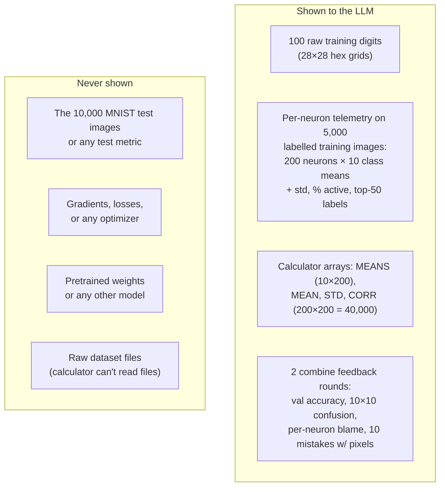

Here is the telemetry itself: each neuron's mean activation per digit, the main signal the model designed against.

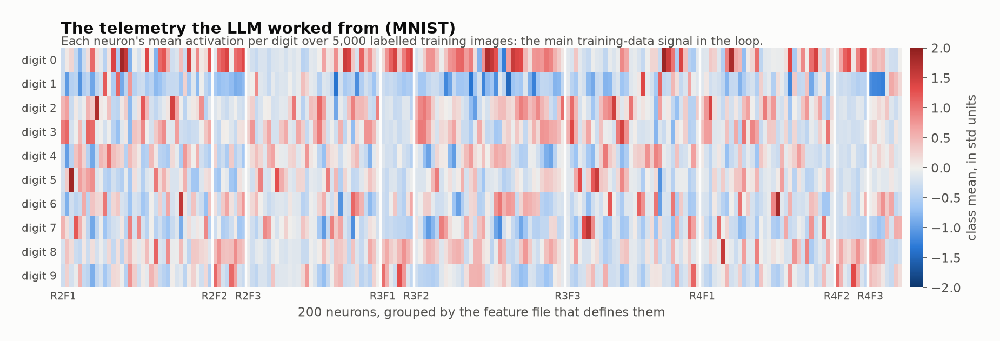

A sample of the table the model actually received (round 4 prompt):

```
neuron                mean|0  mean|1  mean|2  mean|3  mean|4  mean|5  mean|6  mean|7  mean|8  mean|9     std  active  top-50 digits    label
R3F1.0                  0.05    0.00    0.01    0.00    0.02    0.00    0.00    0.00    0.07    0.15    0.11    9.5%  9:30 0:10 8:8 3:1 4:1  8dir strict hole top-left
R3F1.3                  0.27    0.00    0.01    0.03    0.00    0.03    0.11    0.00    0.08    0.01    0.15   15.2%  0:37 8:7 3:2 5:2 6:1 9:1  8dir strict hole bottom-right
```

| Budget item | MNIST 95.93% | Imagenette 67.77% | Imagenette 67.90% |
|---|---|---|---|
| Raw training images in the prompt | 100 | 100 (as 16×16 RGB text **and** as 2 picture sheets) | 100 (same) |
| Explore rounds with telemetry | 4 (1 returned no valid file) | 4 | 5 |
| Neurons measured on 5,000 training images | 200 | 277 | 475 |
| Top-activating training photos shown per neuron | none | none | 6 per neuron (14 sheets) |
| Combine rounds with validation feedback | 2 | 2 | 1 |
| Test-set evaluations shown to the LLM | **0** | **0** | **0** |

---

## 5. Results in detail

All numbers below come from [`audit_verify.py`](audit_verify.py), a clean-room script that imports nothing from this repo. It rebuilds the networks from the JSON weights using plain `torch.nn` layers and evaluates 100% of the official test sets, downloaded fresh through torchvision. They match the harness logs exactly.

| Model file | Dataset / split | Samples | Correct | Top-1 | Params |
|---|---|---|---|---|---|
| [`weights/mnist_95.93.json`](weights/mnist_95.93.json) | MNIST `train=False` | 10,000 | 9,593 | **95.93%** | 6,779 |
| [`weights/imagenette_67.77_5k-params.json`](weights/imagenette_67.77_5k-params.json) | Imagenette 160px `val` | 3,925 | 2,660 | **67.77%** | 5,304 |
| [`weights/imagenette_67.90_57k-params.json`](weights/imagenette_67.90_57k-params.json) | Imagenette 160px `val` | 3,925 | 2,665 | **67.90%** | 57,408 |

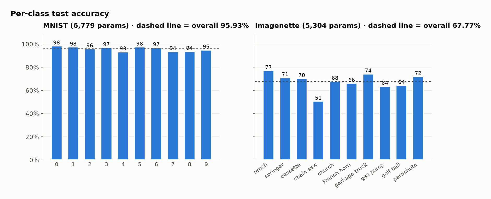

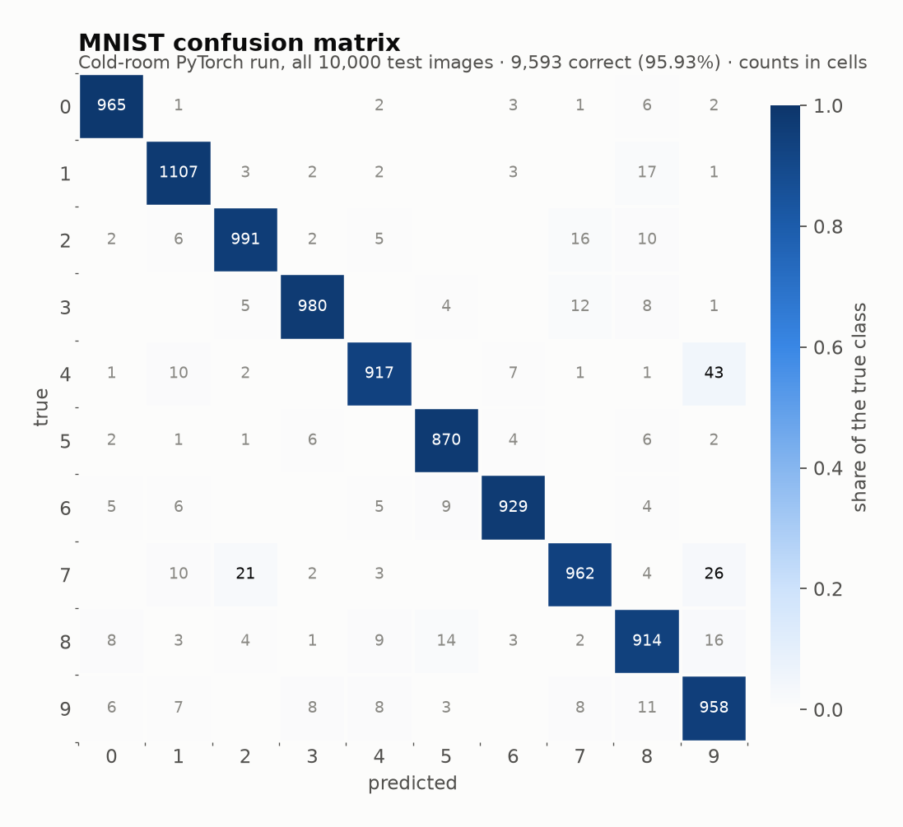

MNIST's main errors: 4→9 (43), 7→9 (26) and 7→2 (21). The open-top/closed-top distinctions the hole detectors were built for remain the hardest.

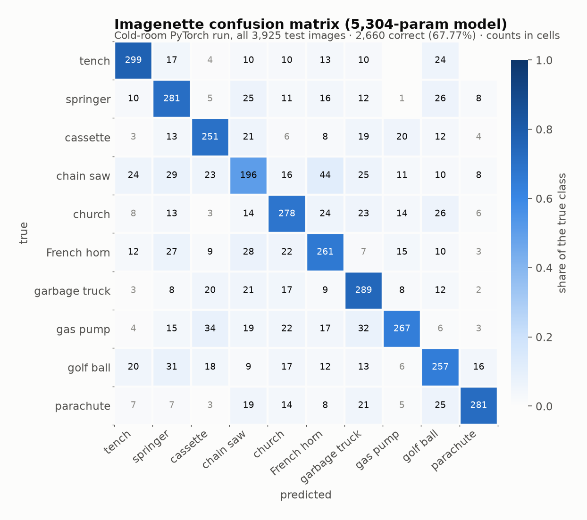

Imagenette's main error: chain saw → French horn (44). Both are metallic objects held by people against cluttered backgrounds, which colour statistics can't separate.

**Architecture.** Each model is several parallel branches (one per feature file) of `Conv2d → ReLU/abs → Avg/MaxPool → Flatten (→ Linear)`, concatenated into one `Linear(N, 10)`. The layers used are `Conv2d` (stride 1), `Linear`, `ReLU`, `abs`, `tanh`, `sigmoid`, `MaxPool2d`, `AvgPool2d`, flatten, scale and shift. There's no HOG, FFT or other hand-written feature code outside the weights.

**Preprocessing.** MNIST is `uint8 / 255`. Imagenette is centre square crop → bicubic resize to 64×64 → `uint8 / 255`. No normalization statistics are used.

---

## 6. How we got here: all 23 runs

This repo includes every run, including the bad ones. The reported numbers are the best run per dataset, so treat them as a best-of.

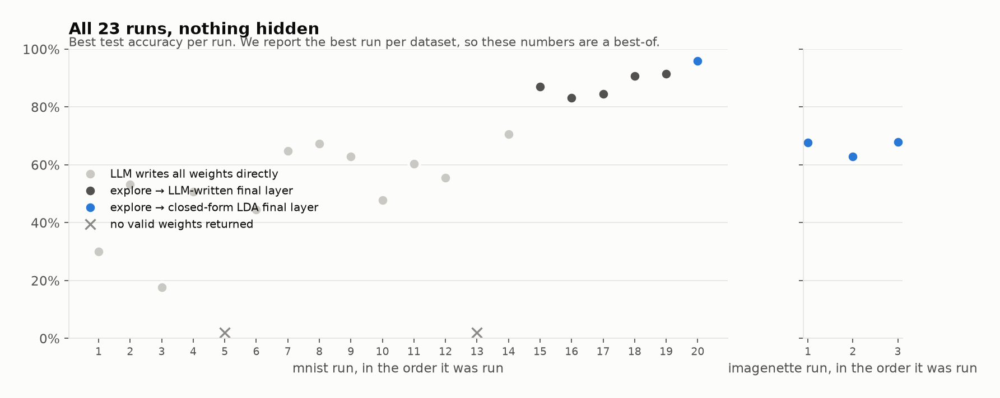

Adding harness features one at a time shows where the accuracy came from:

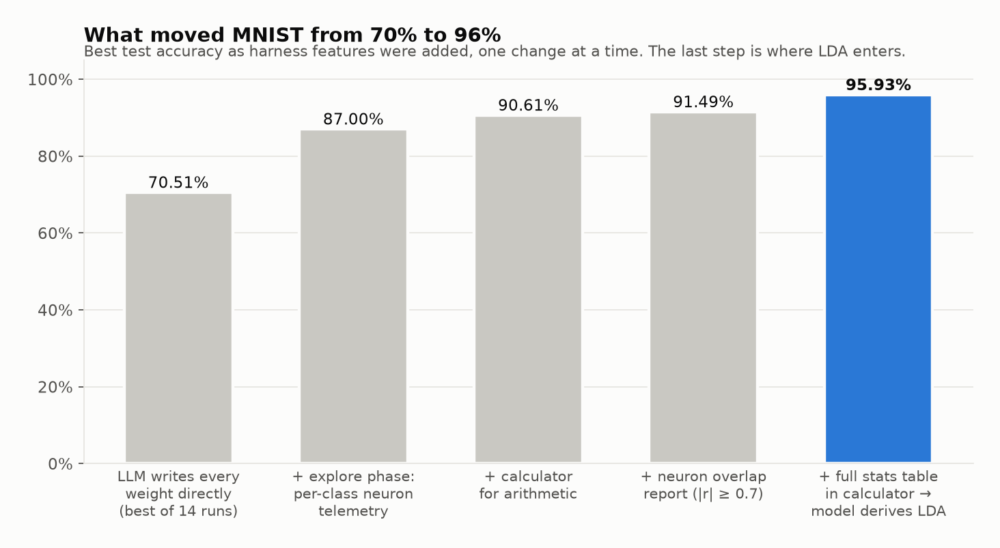

| Stage | Best MNIST test | What changed |
|---|---|---|
| LLM writes every weight directly (14 runs) | 70.51% | No telemetry. It sees sample digits and per-image mistakes. |
| + explore phase (3 runs) | 87.00% | Per-class neuron telemetry. The LLM still hand-writes the final layer. |
| + calculator | 90.61% | The LLM can do arithmetic on the telemetry tables. |
| + overlap report | 91.49% | It's told which neurons are redundant (\|r\| ≥ 0.7). |
| + full statistics table in the calculator | **95.93%** | MEANS/CORR preloaded, and the model derives LDA. |

The biggest single jump (+16.5 points) came from the **explore phase**, where the model designs neurons against telemetry. The second biggest (+4.4) came from handing it the covariance statistics needed for a proper linear readout.

---

## 7. Self-audit

Before publishing, I asked for a hostile, "debunk this on HN" audit of every script, log, prompt and weight file. It found that **my original draft claims were wrong**: "zero training data", "97% / 70%" and "at most 4 calibration steps". This README is the corrected version. The full report is in [docs/AUDIT.md](docs/AUDIT.md).

| Check | Result | Evidence |
|---|---|---|
| Training data leaked into weight design? | **Yes, by design.** Per-class neuron statistics on 5,000 labelled training images, plus 100 raw samples. | [`explore.py:255`](src/weightspace/explore.py) `neuron_stats`; [`explore.py:365`](src/weightspace/explore.py) `write_table` |
| Closed-form solver? | **Yes.** The final layer is regularized LDA via `np.linalg.solve` / `inv`, in all three headline runs. | `calculator.jsonl` in each `results/` folder |
| Pretrained weights / torchvision models / sklearn? | **None.** Dependencies are numpy, pillow, rich. | [`pyproject.toml`](pyproject.toml) |
| Metric correct? | **Yes.** Strict 10-way top-1, `argmax` over all classes, every sample, no early `break`. | [`evaluate.py:19`](src/weightspace/evaluate.py) |
| Test set shown to the LLM? | **No.** Feedback uses a validation slice of the training set; test is scored but never sent. | [`datasets.py:51`](src/weightspace/datasets.py), [`explore.py:671`](src/weightspace/explore.py) |
| Test set influenced choices? | **Indirectly.** Test accuracy was printed to *my* console each round while I iterated on the harness over 23 runs. | [`explore.py:666`](src/weightspace/explore.py) |
| Hidden feature engineering outside the weights? | **No.** Only standard layers; preprocessing is crop/resize/÷255. | [`network.py:126`](src/weightspace/network.py) |
| Could the calculator read the dataset? | **No evidence.** 83 logged snippets checked: none touched files or datasets. The 7 refused snippets were all formatting or saving attempts (`json`, `save`, `eval`). | `calculator.jsonl` |
| Numbers reproduce independently? | **Yes, exactly.** | [`audit_verify.py`](audit_verify.py) |

---

## 8. Claims, precisely

**Supported by this repo:**
- An LLM hand-wrote every convolutional feature weight, with zero gradient steps.
- With a closed-form LDA readout derived from training-set statistics, the networks reach **95.93%** on the MNIST test set (6,779 parameters) and **67.77%** on Imagenette val (5,304 parameters).
- The LLM's feature design is worth **+9 points** (MNIST) and **+29 points** (Imagenette) over random or pixel features under the identical readout.

**Not supported, and not claimed:**
- "Zero training data." The model saw 100 samples, plus class-conditional statistics on 5,000 labelled images.
- "The LLM wrote the final layer." It derived it: the final layer is LDA, computed in a Python tool.
- "No fitting." LDA is a closed-form fit to labelled training statistics. There's no *iterative* optimization, but there is fitting.
- Any accuracy above 95.93% (MNIST) or 67.90% (Imagenette) on a test set.

---

## 9. Reproduce it

```bash
uv sync
```

**Verify the shipped weights** (about 110 MB of fresh downloads, CPU only):

```bash
uv run --extra audit python audit_verify.py
```

Expected: `TOP-1 ACCURACY: 9593/10000 = 95.93%`, `2660/3925 = 67.77%`, `2665/3925 = 67.90%`.

**Run the ablation** (CPU-heavy for a few minutes, pinned to one thread):

```bash
uv run ws-data imagenette
```

```bash
uv run python audit_ablation.py
```

**Regenerate every figure:**

```bash
uv run --with matplotlib python docs/make_figures.py
```

**Run the experiment yourself.** It uses Claude Code in headless mode (`claude -p`) on your Claude subscription. These are the headline MNIST settings:

```bash
uv run ws-explore --samples 100 --explore 4 --combine 3 --calculator --overlap --overlap-table
```

And the headline Imagenette settings:

```bash
uv run ws-explore --dataset imagenette --samples 100 --sheets --calculator --overlap --overlap-table
```

Add `--layered --explore 5 --combine 2` for the deeper 57k-parameter variant. Each run writes its prompts, replies, calculator log, telemetry and weights to `runs/<timestamp>/`.

**Sandbox.** Claude runs with built-in tools disabled (`--tools ""`), no MCP servers except the calculator, and an empty temp folder. The calculator ([`calc_server.py`](src/weightspace/calc_server.py)) only allows numeric imports, refuses file, OS and introspection access, and logs every snippet. It's a guard rail, not a security sandbox; the log is the audit trail. It has a `--backend deepseek` option too, which bills your DeepSeek key.

---

## 10. Repository map

| Path | What |
|---|---|
| [`src/weightspace/explore.py`](src/weightspace/explore.py) | Explore → combine harness (telemetry, bank, LDA statistics table) |
| [`src/weightspace/network.py`](src/weightspace/network.py) | numpy runtime for the JSON weight format; the format is documented in its docstring |
| [`src/weightspace/generate.py`](src/weightspace/generate.py) | Older mode: the LLM writes a whole network directly, with per-image feedback |
| [`src/weightspace/calc_server.py`](src/weightspace/calc_server.py) | The calculator tool (MCP server) with guard rails and logging |
| [`src/weightspace/datasets.py`](src/weightspace/datasets.py), [`data.py`](src/weightspace/data.py) | MNIST / Imagenette loading, validation split, sample prompts |
| [`weights/`](weights) | The three verified models, plus two early zero-shot hand-written MNIST files |
| [`results/`](results) | Full logs of the three headline runs: prompts, replies, `calculator.jsonl`, telemetry table (`bank_table.npz`), every feature file. Photo sheets are omitted. |
| [`audit_verify.py`](audit_verify.py) | Clean-room PyTorch re-evaluation |
| [`audit_ablation.py`](audit_ablation.py) | Same-LDA ablation on pixels and random features |
| [`docs/`](docs) | Figures, figure data and script, and the full audit report |
| [`src/weightspace/walker.py`](src/weightspace/walker.py) | Unrelated side experiment: the same idea for a MuJoCo Walker2d controller (why `gymnasium` is a dependency) |

`data/` and `runs/` are git-ignored. Datasets download on first use, and `runs/` holds local run output.
